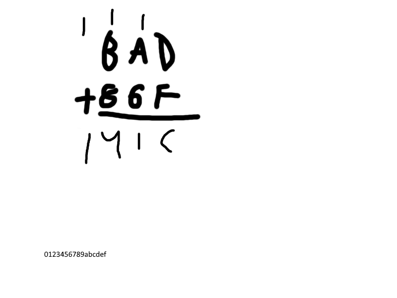
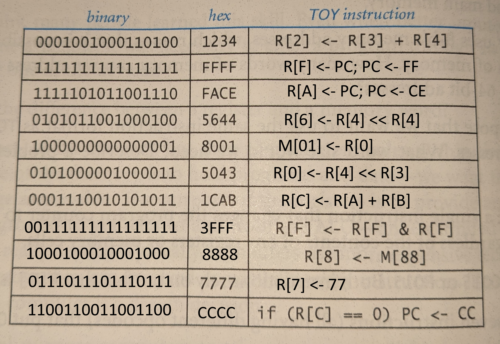

**1. Demonstrate your work adding the following hexadecimal numbers together, using the techniques you learned in grade school to add numbers: BAD + 86F** \
141C \
 \
\
**2. What are some modern examples of programs being treated as data? (Describe at least 3.)** 
1. Any library for programs 
2. Minecraft datapacks 
3. PHP code
\
**3. Fill in the blanks of this table using your textbook as a reference:** \

